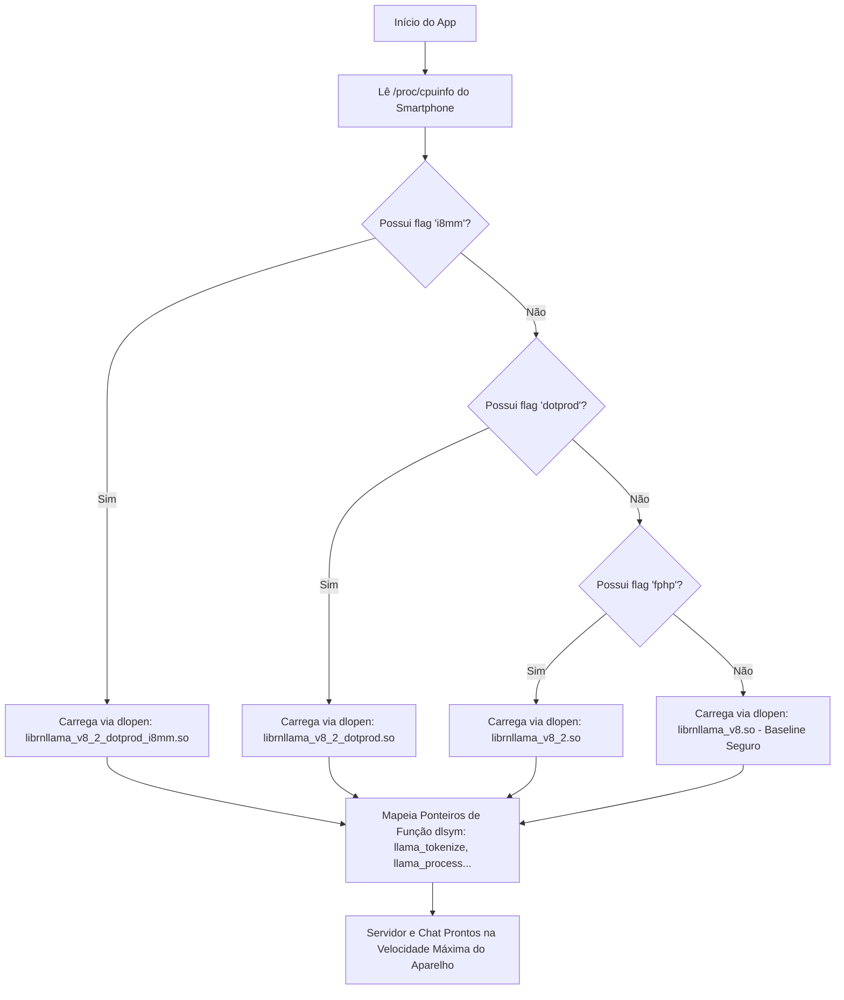

# 📚 Guia de Arquitetura, Estrutura de Pastas e Binários Nativos (.so)

Este documento detalha o funcionamento interno do **MyLocal.AI**, a finalidade de cada pasta do repositório, o papel de cada arquivo de biblioteca nativa (`.so`) herdado do PocketPAL/GGML e o procedimento para você mesmo compilar novas versões diretamente a partir do código-fonte do `llama.cpp`.

---

## 📌 Sumário
1. [O que é um arquivo `.so` (Shared Object)?](#1-o-que-é-um-arquivo-so-shared-object)
2. [Estrutura Completa de Pastas do Projeto](#2-estrutura-completa-de-pastas-do-projeto)
3. [Detalhamento de Cada Arquivo `.so` (Origem PocketPAL)](#3-detalhamento-de-cada-arquivo-so-origem-pocketpal)
4. [Como o MyLocal.AI Carrega os `.so` em Tempo de Execução](#4-como-o-mylocalai-carrega-os-so-em-tempo-de-execução)
5. [Como Compilar Localmente Novos `.so` via `llama.cpp` e NDK](#5-como-compilar-localmente-novos-so-via-llamacpp-e-ndk)

---

## 1. O que é um arquivo `.so` (Shared Object)?

Um arquivo com extensão `.so` (*Shared Object*) é uma **biblioteca compilada em código de máquina nativo** para sistemas operacionais baseados em Linux e Android. 

Ele é o exato equivalente aos arquivos `.dll` do Windows ou `.dylib` do macOS.

### Por que Modelos de Linguagem (LLMs) usam `.so` em vez de Kotlin/Java puro?
- **Desempenho Bruto de CPU:** A máquina virtual do Android (ART / Dalvik) executa bytecode gerenciado. Para operações normais de telas e formulários, isso é ótimo. Porém, a inferência de IA exige bilhões de multiplicações de matrizes por segundo.
- **Instruções Vetoriais de Hardware:** Operações de tensores precisam rodar em instruções especializadas da CPU ARM (como **ARM NEON**, **Dot Product** e **i8mm**). Apenas compiladores C/C++ (como o Clang do Android NDK) conseguem emitir essas instruções de baixo nível diretamente nos núcleos do processador.
- **Ponte JNI:** O Kotlin conversa com esses arquivos nativos através da **JNI (*Java Native Interface*)**, permitindo que o aplicativo tenha a estabilidade e as APIs do Android para a interface e rede, enquanto o motor de cálculo da IA roda com 100% da potência física do processador.

---

## 2. Estrutura Completa de Pastas do Projeto

Abaixo está o mapa de todos os diretórios do projeto e a responsabilidade de cada um:

```text
mylocalai/
├── DOCS/                                # Documentação técnica de arquitetura e desenvolvimento
│   └── ARQUITETURA_E_BINARIOS_SO.md    # Este documento
├── app/                                 # Módulo principal da aplicação Android
│   ├── src/
│   │   └── main/
│   │       ├── AndroidManifest.xml      # Manifesto: permissões (Foreground Service, WakeLock, Internet)
│   │       ├── cpp/                     # Código-fonte nativo em C++ desenvolvido para o MyLocal.AI
│   │       │   ├── CMakeLists.txt       # Script do CMake para compilar a biblioteca llama-jni
│   │       │   ├── llama-jni.cpp        # Ponte JNI: detecta hardware e conecta Kotlin ao C++
│   │       │   └── include/             # Cabeçalhos (.h) da biblioteca GGML / llama.cpp
│   │       │       ├── llama.h          # API principal do llama.cpp (tokenização, modelo, amostragem)
│   │       │       ├── ggml.h           # Estrutura de dados dos tensores e grafos computacionais
│   │       │       ├── gguf.h           # Leitor de arquivos de modelos quantizados .gguf
│   │       │       ├── ggml-cpu.h       # Implementação das operações vetoriais de CPU
│   │       │       ├── ggml-alloc.h     # Alocador estático de memória para tensores
│   │       │       └── ggml-backend.h   # Interface abstrata para backends (CPU, OpenCL, NPU)
│   │       ├── java/com/pocketpal/server/ # Código-fonte em Kotlin
│   │       │   ├── MainActivity.kt      # Controle da tela: tabs, status, seleção de arquivo, logs
│   │       │   ├── LlamaServerService.kt# Foreground Service com WakeLock (mantém servidor ativo 24/7)
│   │       │   ├── HttpApiServer.kt     # Servidor HTTP NanoHTTPD compatível com a API da OpenAI
│   │       │   ├── LlamaEngine.kt       # Singleton Kotlin de controle do ciclo de vida da IA
│   │       │   ├── OpenAiModels.kt      # Classes de modelo de dados Gson (/v1/chat/completions)
│   │       │   └── ChatAdapter.kt       # Adaptador da RecyclerView para o chat nativo na tela
│   │       ├── jniLibs/                 # Bibliotecas C++ pré-compiladas (.so) empacotadas no APK
│   │       │   └── arm64-v8a/           # Binários de 64 bits para processadores ARM modernos
│   │       └── res/                     # Recursos visuais do aplicativo
│   │           ├── layout/              # Telas em XML (activity_main.xml, chat items)
│   │           ├── drawable/            # Estilos visuais, bordas, botões e badges de status
│   │           ├── values/              # Strings, cores de tema escuro e estilos de fonte
│   │           └── mipmap-*/            # Ícones do aplicativo para o launcher do Android
│   └── build.gradle.kts                 # Configuração do módulo app (SDK 34, NDK 26, CMake 3.22, dependências)
├── gradle/wrapper/                      # Gradle Wrapper que baixa a versão correta do Gradle (8.9)
├── build_and_install.bat                # Script interativo Windows para compilar e instalar via ADB
├── compartilhar_apk.bat                 # Script Windows que inicia servidor web Wi-Fi para download do APK
├── compartilhar_apk.sh                  # Versão em Shell Script para compartilhar no Linux/macOS
├── serve_apk.py                         # Servidor Python com página HTML de download para o celular
├── test_api.bat                         # Script Windows para testar requisições na API HTTP local
├── test_api.sh                          # Script Linux para testar endpoints com curl e jq
├── build.gradle.kts                     # Configuração raiz dos plugins Gradle
├── settings.gradle.kts                  # Declaração dos módulos do projeto
├── gradle.properties                    # Parâmetros de compilação da JVM do Gradle
└── README.md                            # Guia completo do usuário e documentação geral
```

---

## 3. Detalhamento de Cada Arquivo `.so` (Origem PocketPAL)

Na pasta [`app/src/main/jniLibs/arm64-v8a/`](file:///c:/Projetos/Kotlin/mylocalai/app/src/main/jniLibs/arm64-v8a) residem as bibliotecas nativas de baixo nível. Elas se originam da compilação do ecossistema do **PocketPAL AI** (que utiliza por baixo o submódulo `react-native-llama` sobre o `llama.cpp`):

```text
app/src/main/jniLibs/arm64-v8a/
├── libc++_shared.so
├── librnllama.so
├── librnllama_v8.so
├── librnllama_v8_2.so
├── librnllama_v8_2_dotprod.so
├── librnllama_v8_2_dotprod_i8mm.so
├── librnllama_v8_2_dotprod_i8mm_hexagon_opencl.so
└── librnllama_jni_*.so
```

### Explicação de Cada Binário:

| Biblioteca | Instruções da CPU / Otimização | Descrição e Papel |
| :--- | :--- | :--- |
| **`librnllama_v8_2_dotprod_i8mm.so`** | `ARMv8.2-A` + `DotProd` + `i8mm` | **A variante mais potente.** Utiliza instruções vetoriais `i8mm` (multiplicação de matrizes de inteiros de 8 bits em hardware). Dobra ou triplica a velocidade de geração em SoCs modernos (Snapdragon 865, 8 Gen 1/2/3, Dimensity 8000/9000, Google Tensor). |
| **`librnllama_v8_2_dotprod.so`** | `ARMv8.2-A` + `DotProd` (`asimddp`) | Otimizada para SoCs que têm produto escalar vetorial acelerado, mas não possuem ainda `i8mm` (ex: Snapdragon 7xx, 845 e 855). |
| **`librnllama_v8_2.so`** | `ARMv8.2-A` + `FP16` (`fphp`) | Otimizada com instruções de ponto flutuante de 16 bits nativas (Half-Precision Float). |
| **`librnllama_v8.so`** | `ARMv8.0-A` (Baseline ARM NEON) | **Compatibilidade universal.** Não usa nenhuma extensão opcional. Roda em absolutamente qualquer celular Android de 64 bits (Cortex-A53, chips básicos MediaTek Helio). |
| **`librnllama.so`** | Genérica da engine | Fallback genérico da engine GGML. |
| **`librnllama_..._hexagon_opencl.so`**| OpenCL + Qualcomm Hexagon DSP | Variante compilada com suporte a aceleradores gráficos (GPU Adreno via OpenCL) e coprocessador de sinal digital (DSP Hexagon). |
| **`librnllama_jni_*.so`** | Pontes legadas JNI | Eram as pontes usadas pelo React Native do PocketPAL. No MyLocal.AI substituímos isso por nosso próprio `llama-jni.cpp`, mas mantivemos os arquivos para evitar quebra de links estáticos. |
| **`libc++_shared.so`** | Runtime C++ do Android NDK | A biblioteca padrão da linguagem C++ (`std::string`, `std::vector`, `std::thread`, alocadores e exceções). Imprescindível para o funcionamento de todas as outras. |

---

## 4. Como o MyLocal.AI Carrega os `.so` em Tempo de Execução

Em vez de forçar uma única biblioteca estática que quebraria em aparelhos antigos ou rodaria de forma lenta em celulares modernos, o arquivo [`app/src/main/cpp/llama-jni.cpp`](file:///c:/Projetos/Kotlin/mylocalai/app/src/main/cpp/llama-jni.cpp) adota uma estratégia de **Seleção Dinâmica em Tempo de Execução**:



Dessa forma, o mesmo APK instala e roda com a **máxima velocidade possível** tanto num celular top de linha de 2026 quanto num smartphone de entrada de 2018.

---

## 5. Como Compilar Localmente Novos `.so` via `llama.cpp` e NDK

Se você quiser atualizar a engine para a versão mais recente do [llama.cpp](https://github.com/ggerganov/llama.cpp), você pode compilar essas bibliotecas na sua própria máquina Windows ou Linux utilizando o Android NDK já instalado.

### 5.1. Pré-Requisitos na sua Máquina
- **Android NDK:** Localizado em `C:\Users\User\AppData\Local\Android\Sdk\ndk\26.1.10909125`
- **CMake:** Localizado em `C:\Users\User\AppData\Local\Android\Sdk\cmake\3.22.1\bin\cmake.exe`
- **Código-Fonte:** Repositório do `llama.cpp` clonado localmente:
  ```bash
  git clone --recursive https://github.com/ggerganov/llama.cpp
  cd llama.cpp
  ```

---

### 5.2. Compilando as Variantes no Windows (PowerShell)

Defina as variáveis com os caminhos das ferramentas:
```powershell
$NDK = "C:\Users\User\AppData\Local\Android\Sdk\ndk\26.1.10909125"
$TOOLCHAIN = "$NDK\build\cmake\android.toolchain.cmake"
$CMAKE = "C:\Users\User\AppData\Local\Android\Sdk\cmake\3.22.1\bin\cmake.exe"
```

#### A. Compilar a Variante Ultra Rápida (`DotProd + i8mm`):
```powershell
# 1. Criar pasta de saída
mkdir build-arm64-i8mm
cd build-arm64-i8mm

# 2. Configurar o CMake para o Android NDK (ARM64)
& $CMAKE .. `
  -DCMAKE_TOOLCHAIN_FILE="$TOOLCHAIN" `
  -DANDROID_ABI="arm64-v8a" `
  -DANDROID_PLATFORM="android-26" `
  -DCMAKE_BUILD_TYPE=Release `
  -DBUILD_SHARED_LIBS=ON `
  -DGGML_BUILD_TESTS=OFF `
  -DGGML_BUILD_EXAMPLES=OFF `
  -DCMAKE_C_FLAGS="-march=armv8.2-a+dotprod+i8mm -O3" `
  -DCMAKE_CXX_FLAGS="-march=armv8.2-a+dotprod+i8mm -O3"

# 3. Executar a compilação paralela
& $CMAKE --build . --config Release -j 8
cd ..
```

#### B. Compilar a Variante Intermediária (`DotProd`):
Altere apenas a pasta e as flags do compilador:
```powershell
mkdir build-arm64-dotprod
cd build-arm64-dotprod

& $CMAKE .. `
  -DCMAKE_TOOLCHAIN_FILE="$TOOLCHAIN" `
  -DANDROID_ABI="arm64-v8a" `
  -DANDROID_PLATFORM="android-26" `
  -DCMAKE_BUILD_TYPE=Release `
  -DBUILD_SHARED_LIBS=ON `
  -DGGML_BUILD_TESTS=OFF `
  -DGGML_BUILD_EXAMPLES=OFF `
  -DCMAKE_C_FLAGS="-march=armv8.2-a+dotprod -O3" `
  -DCMAKE_CXX_FLAGS="-march=armv8.2-a+dotprod -O3"

& $CMAKE --build . --config Release -j 8
cd ..
```

#### C. Compilar a Variante Universal (`ARMv8.0 Baseline`):
```powershell
mkdir build-arm64-baseline
cd build-arm64-baseline

& $CMAKE .. `
  -DCMAKE_TOOLCHAIN_FILE="$TOOLCHAIN" `
  -DANDROID_ABI="arm64-v8a" `
  -DANDROID_PLATFORM="android-26" `
  -DCMAKE_BUILD_TYPE=Release `
  -DBUILD_SHARED_LIBS=ON `
  -DGGML_BUILD_TESTS=OFF `
  -DGGML_BUILD_EXAMPLES=OFF `
  -DCMAKE_C_FLAGS="-march=armv8-a -O3" `
  -DCMAKE_CXX_FLAGS="-march=armv8-a -O3"

& $CMAKE --build . --config Release -j 8
cd ..
```

---

### 5.3. Onde encontrar e como colocar no projeto MyLocal.AI
Após a compilação, o CMake terá gerado em cada pasta de build os arquivos:
- `libllama.so`
- `libggml.so` (ou fundidos na mesma biblioteca compartilhada)

Basta renomear e copiar os binários para a pasta [`app/src/main/jniLibs/arm64-v8a/`](file:///c:/Projetos/Kotlin/mylocalai/app/src/main/jniLibs/arm64-v8a):
- A build `i8mm` substitui `librnllama_v8_2_dotprod_i8mm.so`
- A build `dotprod` substitui `librnllama_v8_2_dotprod.so`
- A build `baseline` substitui `librnllama_v8.so`

Em seguida, basta recompilar o aplicativo Android com `./gradlew assembleDebug` ou `build_and_install.bat`!
