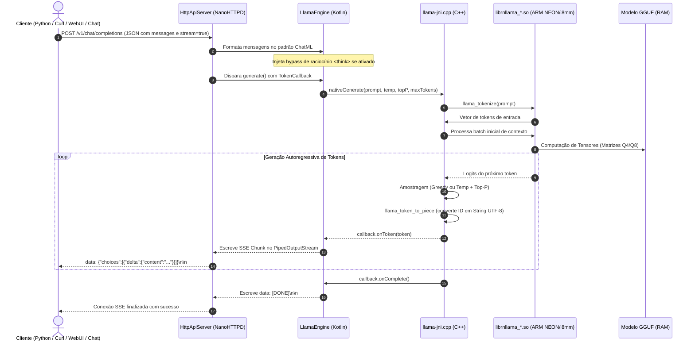

# 🚀 MyLocal.AI (Servidor de IA Local Android Nativo)

<p align="center">
  
</p>

<p align="center">
  <b>Servidor de IA Local e Nativo para Android com API HTTP Compatível com OpenAI (<code>/v1/chat/completions</code>) & Inferência Acelerada por Hardware GGML/llama.cpp.</b>
</p>

<p align="center">
  
  
  
  
  
  
</p>

---

## 📌 Sumário
1. [Sobre o Projeto](#-sobre-o-projeto)
2. [Arquivos Reaproveitados do PocketPAL vs. Desenvolvidos do Zero](#-arquivos-reaproveitados-do-pocketpal-vs-desenvolvidos-do-zero)
3. [Pipeline de Execução de Mensagens (End-to-End)](#-pipeline-de-execução-de-mensagens-end-to-end)
4. [Benefícios de uma IA Local com API Própria](#-benefícios-de-uma-ia-local-com-api-própria)
5. [Dependências e Requisitos](#-dependências-e-requisitos)
6. [Instalação das Dependências (Passo a Passo)](#-instalação-das-dependências-passo-a-passo)
7. [Scripts Automatizados (Batch .bat e Shell .sh)](#-scripts-automatizados-batch-bat-e-shell-sh)
8. [Como Usar a API OpenAI Local](#-como-usar-a-api-openai-local)

---

## 💡 Sobre o Projeto

O **MyLocalAI** transforma qualquer celular ou tablet Android (ARM64) em um **servidor de inteligência artificial de alta performance**. 

Diferente de soluções pesadas ou wrappers lentos, o MyLocalAI roda modelos quantizados no formato `.gguf` (como Qwen 2.5, Llama 3.2, Mistral, Gemma 2 e DeepSeek-R1 Distill) diretamente nos núcleos de processamento do processador móvel (ARM NEON, Dot Product e i8mm), expondo uma **API HTTP REST 100% compatível com a especificação OpenAI**.

Qualquer ferramenta, script ou interface capaz de se comunicar com a OpenAI (LangChain, LlamaIndex, Open WebUI, Chatbox, Cursor, Continue.dev, scripts Python com o SDK oficial `openai`) pode se conectar ao IP do seu smartphone na rede Wi-Fi local e obter respostas em tempo real por streaming (SSE).

---

## 🔍 Arquivos Reaproveitados do PocketPAL vs. Desenvolvidos do Zero

O **PocketPAL AI** original é um aplicativo desenvolvido sobre **React Native**, o que implica no carregamento da engine JavaScript Hermes, bridge de serialização JSON e um grande consumo de memória RAM apenas para manter a interface web/mobile ativa.

Para atingir a máxima performance e estabilidade contínua de servidor (24/7 em background), o **MyLocalAI** foi **reconstruído nativamente em Kotlin e C++**, reaproveitando exclusivamente os binários nativos de baixo nível compilados e validados pelo ecossistema do PocketPAL:

| Componente | Origem | Descrição / Papel no Projeto |
| :--- | :--- | :--- |
| **`app/src/main/jniLibs/arm64-v8a/*.so`** | **Reaproveitado do PocketPAL** | Binários C++ compilados para ARM64 com suporte a instruções avançadas: `librnllama_v8_2_dotprod_i8mm.so` (DotProd + i8mm), `librnllama_v8_2_dotprod.so`, `librnllama_v8_2.so` (FP16), `librnllama_v8.so` e variantes com suporte a OpenCL/Hexagon NPU. |
| **`app/src/main/cpp/include/*.h`** | **Reaproveitado do PocketPAL** | Headers C/C++ da biblioteca GGML / llama.cpp (`llama.h`, `ggml.h`, `gguf.h`, `ggml-alloc.h`, `ggml-cpu.h`, `ggml-backend.h`, `ggml-opt.h`) que definem as estruturas de dados dos tensores e do modelo. |
| **`app/src/main/res/mipmap-*/ic_launcher.png`** | **Reaproveitado do PocketPAL** | Ícones de identidade visual do aplicativo. |
| **`app/src/main/cpp/llama-jni.cpp`** | ⚡ **Desenvolvido do Zero (Nativo)** | Ponte JNI personalizada com **carregador dinâmico (`dlopen`/`dlsym`)**. Inspeciona `/proc/cpuinfo` em tempo de execução para selecionar automaticamente a biblioteca `.so` mais rápida suportada pelo hardware do aparelho, além de gerenciar tokenização, amostragem e cancelamento. |
| **`HttpApiServer.kt`** | ⚡ **Desenvolvido do Zero (Nativo)** | Servidor HTTP leve embutido usando **NanoHTTPD**. Implementa endpoints `/health`, `/v1/models`, `/v1/chat/completions` (com suporte a SSE - Server-Sent Events para streaming em tempo real) e cabeçalhos de CORS. |
| **`LlamaEngine.kt`** | ⚡ **Desenvolvido do Zero (Nativo)** | Motor Kotlin thread-safe com conversão de mensagens para sintaxe ChatML e **otimizador de pensamento `<think>`** (injeta o fechamento da tag `<think>\n</think>` para modelos de raciocínio como DeepSeek-R1 responderem instantaneamente sem perda de tempo em monólogos). |
| **`LlamaServerService.kt`** | ⚡ **Desenvolvido do Zero (Nativo)** | Android Foreground Service com `PARTIAL_WAKE_LOCK` e `WIFI_MODE_FULL_HIGH_PERF`, garantindo que o servidor permaneça ativo mesmo com a tela desligada e o celular no bolso ou na tomada. |
| **`MainActivity.kt` & Chat Local** | ⚡ **Desenvolvido do Zero (Nativo)** | Interface nativa em abas (Dashboard de controle do servidor com monitor de logs em tempo real + aba de Chat para testar o modelo diretamente no aparelho sem precisar de PC). |
| **`OpenAiModels.kt`** | ⚡ **Desenvolvido do Zero (Nativo)** | Contratos de dados Gson seguindo a especificação RFC do OpenAI REST API v1. |

---

## 🔄 Pipeline de Execução de Mensagens (End-to-End)

Quando uma requisição chega ao MyLocalAI (seja via HTTP por um cliente externo ou pela própria interface de chat), ela percorre o seguinte fluxo de alto desempenho:



### Explicação Passo a Passo das Camadas:
1. **Recepção HTTP e CORS (`HttpApiServer.kt`)**: O NanoHTTPD escuta na porta configurada (padrão `8080`) e libera requisições de origens cruzadas (CORS `*`), permitindo conexão direta a partir de navegadores e Web UIs.
2. **Formatação ChatML e Otimização `<think>` (`LlamaEngine.kt`)**: 
   - Transforma a lista de mensagens no formato padrão aceito pelo modelo: `<|im_start|>role\ncontent<|im_end|>`.
   - **Bypass de Pensamento**: Se ativado, pré-injeta `<think>\n</think>` no início da mensagem do assistente. Isso faz com que modelos baseados em raciocínio (como DeepSeek-R1) pulem o bloco de raciocínio interno e entreguem a resposta objetiva imediatamente.
3. **Ponte JNI (`llama-jni.cpp`)**: A string UTF-8 é convertida em tokens inteiros usando o vocabulário carregado em memória.
4. **Cálculo de Tensores (`librnllama_*.so`)**: Os tokens entram no contexto de memória (KV cache). O GGML utiliza as extensões de vetorização de hardware do seu processador ARM para computar a matriz de probabilidades (logits).
5. **Streaming em Tempo Real**: À medida que cada token é previsto, ele é decodificado para texto e despachado imediatamente através de uma `PipedInputStream`/`PipedOutputStream` via protocolo Server-Sent Events (SSE), criando o efeito de digitação instantânea para o usuário.

---

## 💎 Benefícios de uma IA Local com API Própria

Adotar uma IA rodando em um servidor local compatível com a API da OpenAI oferece vantagens estratégicas imediatas:

| Benefício | Descrição |
| :--- | :--- |
| 🛡️ **Privacidade Absoluta (Zero Leaks)** | Os dados enviados (mensagens, prontuários, contratos, dados bancários, código privado) **nunca saem do seu dispositivo ou rede local**. 100% em conformidade com **LGPD** e **GDPR**. |
| 💰 **Custo Zero Vitalício** | Chega de assinaturas mensais ou faturas surpresa baseadas no consumo de tokens da OpenAI, Claude ou Gemini. Você pode rodar milhões de requisições de graça. |
| ✈️ **Operação 100% Offline** | Funciona em aviões, áreas rurais, servidores isolados (Air-gapped) ou em cenários de queda de internet. |
| 🔌 **Compatibilidade Universal (OpenAI Standard)** | Como implementa o endpoint padrão `/v1/chat/completions`, você não precisa reprogramar seus sistemas: basta alterar a URL de conexão (`base_url`) no LangChain, LlamaIndex, Open WebUI, Chatbox, Cursor ou no script Python oficial. |
| 📱 **Reaproveitamento de Celulares Antigos** | Aquele smartphone sobressalente com tela quebrada ou bateria boa pode se tornar um servidor dedicado de IA em sua mesa ou rack, consumindo pouquíssima energia (~5W contra 400W de um desktop com GPU). |
| ⚡ **Sem Censura e Sem Rate Limits** | Sem bloqueios arbitrários de "muitas requisições por minuto" (429 Too Many Requests) e você escolhe o alinhamento e as instruções de sistema do seu modelo. |

---

## 📦 Dependências e Requisitos

### 1. Hardware Mínimo Recomendado
* **Processador:** ARM64 (64-bit) com suporte a instruções NEON (SoCs Snapdragon 7xx/8xx, Dimensity 7000/8000/9000 ou equivalentes modernos).
* **Memória RAM:** 
  * Para modelos de **0.5B a 1.5B parâmetros:** Mínimo de 3 GB de RAM livres.
  * Para modelos de **3B parâmetros:** Mínimo de 4 a 6 GB de RAM livres.
* **Armazenamento:** Espaço suficiente para salvar os arquivos `.gguf` (geralmente entre 400MB e 3GB).

### 2. Software para Compilação
* **Java Development Kit (JDK):** Versão **17** (LTS).
* **Android SDK:** Plataforma de compilação **API 34** (Android 14) e Build-Tools **34.0.0**.
* **Android NDK:** Versão **`26.1.10909125`** (especificada no projeto).
* **CMake:** Versão **`3.22.1`**.
* **Android Debug Bridge (ADB):** Para instalação direta via cabo USB ou Wi-Fi.

---

## 🛠️ Instalação das Dependências (Passo a Passo)

### Modo Recomendado: Via Android Studio

1. Baixe e instale o [Android Studio](https://developer.android.com/studio) (versão Iguana, Jellyfish, Koala ou superior).
2. Abra o Android Studio e vá em:
   * **Settings (Configurações)** ➔ **Languages & Frameworks** ➔ **Android SDK**.
3. Na aba **SDK Platforms**:
   * Marque a opção: `Android 14.0 ("UpsideDownCake")` (API 34).
4. Na aba **SDK Tools**:
   * Marque **Show Package Details** no canto inferior direito.
   * Procure por **NDK (Side by side)** e selecione a versão **`26.1.10909125`**.
   * Procure por **CMake** e selecione a versão **`3.22.1`**.
   * Certifique-se de que o **Android SDK Platform-Tools** está marcado.
5. Clique em **Apply** e aguarde o download e instalação automática.
6. Certifique-se de que o seu JDK está configurado para a versão 17 em **Build, Execution, Deployment ➔ Build Tools ➔ Gradle ➔ Gradle JDK**.

### Configuração da Variável de Ambiente `JAVA_HOME` (Para Terminal e Scripts .bat/.sh)

Se você for compilar via terminal ou usar o script `build_and_install.bat`, certifique-se de que a variável de ambiente `JAVA_HOME` aponta para a instalação do JDK 17:

* **Windows (PowerShell):**
  ```powershell
  # Instalar JDK 17 via winget (se ainda não tiver)
  winget install EclipseAdoptium.Temurin.17.JDK

  # Definir a variável JAVA_HOME permanentemente no usuário
  [Environment]::SetEnvironmentVariable("JAVA_HOME", "C:\Program Files\Eclipse Adoptium\jdk-17.0.20.101-hotspot", "User")
  ```

* **Linux (Ubuntu / Debian):**
  ```bash
  sudo apt install openjdk-17-jdk
  echo 'export JAVA_HOME=/usr/lib/jvm/java-17-openjdk-amd64' >> ~/.bashrc
  source ~/.bashrc
  ```
---

## ⚡ Scripts Automatizados (Batch .bat e Shell .sh)

Para facilitar a vida de quem não quer abrir a IDE toda vez que for compilar ou testar, foram criados scripts prontos na raiz do repositório:

### 1. Script para Windows (`build_and_install.bat`)
Dê um duplo clique no arquivo [`build_and_install.bat`](build_and_install.bat) ou execute no Prompt de Comando:
```cmd
build_and_install.bat
```
O script interativo permite:
* Detectar o Java JDK e o Android SDK automaticamente.
* Gerar o APK de Release otimizado.
* Instalar o APK diretamente no celular via cabo USB com ADB.
* Abrir o aplicativo no celular automaticamente após a instalação.

### 2. Script de Teste de API no Windows (`test_api.bat`)
```cmd
test_api.bat
```
Solicita o IP do celular na rede Wi-Fi e executa testes instantâneos no `/health`, `/v1/models` e uma chamada completa de streaming no `/v1/chat/completions`.

### 3. Compilação no Linux / macOS (Terminal)
```bash
# Permissão de execução para o Gradle wrapper e scripts
chmod +x gradlew test_api.sh

# Compilar o APK Release
./gradlew assembleRelease

# Instalar no dispositivo via ADB
adb install -r app/build/outputs/apk/release/app-release.apk

# Testar a API
./test_api.sh 192.168.1.50:8080
```

---

## 🌐 Como Usar a API OpenAI Local

### 1. Preparação no Celular
1. Abra o app **MyLocal.AI** no celular.
2. Toque em **"Selecionar Modelo (.gguf)"** e escolha um modelo salvo no aparelho (baixe arquivos GGUF leves do Hugging Face, por exemplo: `Qwen2.5-0.5B-Instruct-Q4_K_M.gguf` ou `Llama-3.2-1B-Instruct-Q4_K_M.gguf`).
3. Ajuste a quantidade de Threads (o app pré-seleciona a quantidade ideal de núcleos rápidos da sua CPU).
4. Clique em **"Iniciar Servidor Local"**.
5. Observe o endereço IP exibido na tela (ex: `http://192.168.1.105:8080`).

---

### 2. Exemplos de Consumo da API

#### A. Verificando Saúde do Servidor
```bash
curl http://<IP-DO-CELULAR>:8080/health
```
**Resposta JSON:**
```json
{
  "status": "online",
  "app": "MyLocal.AI Server",
  "backend": "ARMv8.2 + DotProd + i8mm (Ultra Rápido)",
  "model_loaded": true,
  "current_model": "Qwen2.5-0.5B-Instruct-Q4_K_M.gguf",
  "think_disabled": true,
  "stream_disabled": false
}
```

#### B. Requisição com Streaming via cURL
```bash
curl -N -X POST "http://<IP-DO-CELULAR>:8080/v1/chat/completions" \
  -H "Content-Type: application/json" \
  -d '{
    "messages": [
      {"role": "system", "content": "Você é um assistente técnico conciso."},
      {"role": "user", "content": "O que é computação quântica em 2 frases?"}
    ],
    "temperature": 0.7,
    "stream": true
  }'
```

#### C. Python (Usando o SDK Oficial da OpenAI)
```python
# Instalação: pip install openai
from openai import OpenAI

client = OpenAI(
    base_url="http://<IP-DO-CELULAR>:8080/v1",
    api_key="nao-necessario"
)

response = client.chat.completions.create(
    model="local-model",
    messages=[
        {"role": "user", "content": "Explique o conceito de gravidade em 2 frases."}
    ],
    stream=True
)

for chunk in response:
    content = chunk.choices[0].delta.content
    if content:
        print(content, end="", flush=True)
print()
```

#### D. Uso em Interfaces Web (Open WebUI, Chatbox, LibreChat)
* **Base URL:** `http://<IP-DO-CELULAR>:8080/v1`
* **API Key:** Qualquer texto (ex: `local`)
* **Model Name:** Deixe em branco ou use `local-llama`

---

## 📄 Licença

Este projeto é disponibilizado sob a licença **Apache 2.0**. As bibliotecas de inferência nativas utilizam o motor [llama.cpp / GGML](https://github.com/ggerganov/llama.cpp) sob licença MIT.
